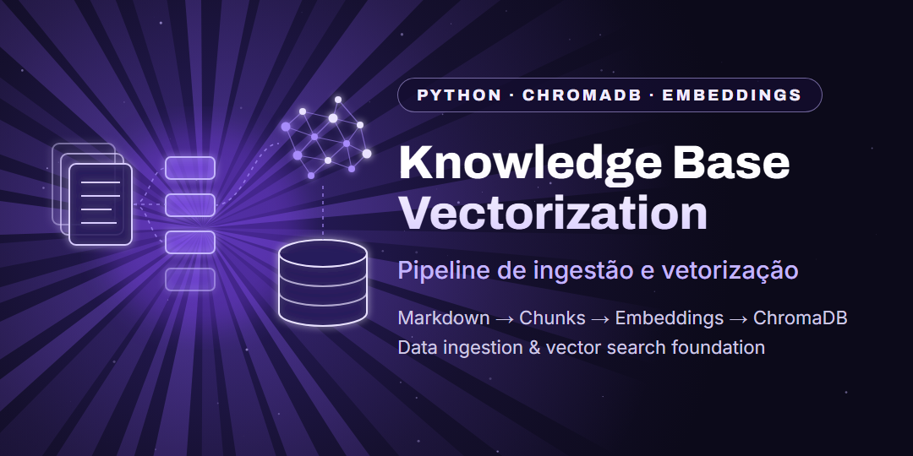

<p align="center">
  
</p>

<p align="center">
  <b>🇺🇸 English</b> · <a href="README.pt-BR.md">🇧🇷 Português</a>
</p>

<p align="center">
  
  
  
  
</p>

# Knowledge Base — Data Ingestion & Vectorization Pipeline

A Python-based pipeline designed to transform technical documentation and support tickets into searchable vector representations using ChromaDB as a local vector database.

This project explores the foundations of an AI-powered knowledge system: unstructured documents are processed, divided into chunks, converted into embeddings, and stored in a vector database, creating the foundation for future semantic search, RAG, and LLM applications.

> **Note:** This is a portfolio project. All data included in this repository is synthetic and fictional. No real customer data, tickets, or private company information is included.

---

## Current Architecture

```text
Markdown Documents
        ↓
Document Ingestion
        ↓
Text Processing
        ↓
Chunking
        ↓
Embedding Generation
        ↓
ChromaDB
        ↓
Vector Storage
```

### Currently Implemented

* Markdown document ingestion
* Text processing and sanitization
* Document chunking
* Embedding generation
* Vector storage using ChromaDB
* Environment-based path configuration
* Synthetic technical knowledge dataset
* Knowledge-base preparation scripts

### Not Currently Implemented

* RAG
* LLM integration
* PostgreSQL
* AI agents
* Conversational interface
* Semantic retrieval layer

---

## Technologies

* **Python** — primary programming language
* **ChromaDB** — local vector database
* **ONNX Runtime** — embedding execution
* **all-MiniLM-L6-v2** — embedding model
* **python-dotenv** — environment-based configuration
* **Regular Expressions (`re`)** — text processing and sanitization
* **Markdown** — knowledge source format

---

## How It Works

The pipeline takes Markdown documents containing technical information and transforms them into data that can be stored and later searched semantically.

### 1. Ingestion

Markdown files located under `knowledge/` are discovered and loaded by the pipeline.

### 2. Processing

Documents go through text cleaning and processing steps.

### 3. Chunking

Larger documents are divided into smaller chunks.

The current implementation uses a fixed-character chunking strategy with overlap between consecutive chunks.

```text
Document
    ↓
Chunk 1
    ↓
Chunk 2
    ↓
Chunk 3
    ↓
...
```

The overlap helps preserve context between consecutive document segments.

### 4. Embeddings

Each chunk is converted into a vector representation using the embedding model.

Conceptually:

```text
"Database connection error"
              ↓
          Embedding
              ↓
     [vector representation]
```

These representations allow the system to compare text based on semantic similarity.

### 5. ChromaDB

The chunks and their corresponding embeddings are stored in ChromaDB.

The vector database is generated locally during execution and is intentionally excluded from the Git repository.

---

## Project Structure

```text
knowledge-base-vectorization/
│
├── docs/
│   └── banner.png
│
├── knowledge/                          # synthetic source documents
│   ├── 001_Troubleshooting_SGV_Limpo.md
│   ├── dicionario_bruto.txt
│   ├── 000_Dicionario_Oficial.md       # generated by estruturar_dicionario.py (not versioned)
│   └── tickets/                        # generated by sanitizar_tickets.py (not versioned)
│
├── scripts/
│   ├── estruturar_dicionario.py        # raw dictionary → structured Markdown
│   ├── preparar_scripts_sql.py         # adds headers + UTF-8 to SQL scripts
│   ├── sanitizar_tickets.py            # removes sensitive fields from tickets
│   └── teste_busca.py                  # quick semantic search test
│
├── src/
│   └── ingestion/
│       └── vetorizar_base.py           # chunking + embeddings + ChromaDB
│
├── tests/
├── .env.example
├── .gitignore
├── LICENSE
├── README.md
├── README.pt-BR.md
└── requirements.txt
```

---

## Installation

### 1. Clone the repository

```bash
git clone https://github.com/jmarques-data/knowledge-base-vectorization.git
cd knowledge-base-vectorization
```

### 2. Create a virtual environment

#### Windows

```bash
python -m venv venv
venv\Scripts\activate
```

#### Linux / macOS

```bash
python -m venv venv
source venv/bin/activate
```

### 3. Install dependencies

```bash
pip install -r requirements.txt
```

### 4. Configure environment variables

Copy `.env.example` to `.env`.

#### Windows

```bash
copy .env.example .env
```

#### Linux / macOS

```bash
cp .env.example .env
```

Adjust the paths if necessary.

---

## Additional Windows Requirement

ChromaDB uses ONNX Runtime for embedding generation.

Depending on the local Windows environment, the following runtime may be required:

**Microsoft Visual C++ Redistributable 2015–2022**

Without the required Visual C++ runtime libraries, ONNX Runtime may fail to load its native DLLs.

This requirement depends on the local environment.

---

## Usage

### 1. Prepare the documents

Run the preparation scripts:

```bash
python scripts/sanitizar_tickets.py
python scripts/estruturar_dicionario.py
python scripts/preparar_scripts_sql.py
```

The scripts process the synthetic documents located under `knowledge/`.

### 2. Vectorization

Run the main ingestion pipeline:

```bash
python src/ingestion/vetorizar_base.py
```

The pipeline performs:

```text
Markdown
   ↓
Text Processing
   ↓
Chunking
   ↓
Embeddings
   ↓
ChromaDB
```

A local `vector_db/` directory is generated during execution.

This directory is a generated artifact and is excluded from Git.

### 3. Quick search test

After vectorization, run a sample query against ChromaDB:

```bash
python scripts/teste_busca.py
```

The script searches for a sample troubleshooting question and prints the closest chunk, its distance and its metadata. It is a simple validation, not yet a full retrieval layer.

---

## Dataset

To prevent exposure of private information, this repository uses only synthetic data.

The examples simulate technical scenarios such as:

* network problems;
* offline cameras;
* SSL certificate expiration;
* firewall blocks;
* database deadlocks;
* troubleshooting procedures.

The data was specifically created to demonstrate the pipeline and does not represent real customers or production environments.

---

## Security

The public version of the project does not contain:

* real tickets;
* customer data;
* internal documentation;
* credentials;
* API keys;
* tokens;
* production vector databases;
* proprietary information;
* personal development-machine paths.

Real data used during development remains outside the public repository.

The `.gitignore` also prevents local artifacts such as `.env`, virtual environments, and `vector_db/` from being committed.

---

## Current Limitations

The project is currently in an early development stage.

### Automated Tests

The test directory exists, but a complete automated test suite has not yet been implemented.

### Chunking

The current strategy uses fixed-character chunking.

This works for the demonstration but may split sentences or Markdown structures at unnatural boundaries.

Future implementations may use chunking based on:

* Markdown headers;
* paragraphs;
* sections;
* semantic boundaries;
* context-aware chunk sizes.

### Semantic Search

The current pipeline generates and stores embeddings but does not yet provide a complete user-facing semantic retrieval layer.

### RAG

Retrieval-Augmented Generation has not yet been implemented.

### LLM

No language model is currently integrated into the project.

---

# Roadmap

The long-term goal is to evolve this pipeline into a complete AI-powered knowledge system.

## 1. Semantic Retrieval

Implement a retrieval layer capable of receiving a user query and finding the most relevant chunks from ChromaDB.

```text
User Query
    ↓
Query Embedding
    ↓
ChromaDB Search
    ↓
Relevant Chunks
```

## 2. RAG Pipeline

Introduce a Retrieval-Augmented Generation architecture.

```text
User Query
    ↓
Semantic Search
    ↓
Relevant Context
    ↓
Prompt Construction
    ↓
LLM
    ↓
Response
```

## 3. LLM Integration

Connect the knowledge system to a language model that can generate responses based on retrieved context.

Potential providers include:

* OpenAI
* Anthropic
* Gemini
* other compatible models

## 4. Hybrid Database Architecture

Introduce PostgreSQL for structured information while keeping ChromaDB responsible for vector storage and semantic search.

Planned architecture:

```text
             Knowledge System
                    │
          ┌─────────┴─────────┐
          ↓                   ↓
     PostgreSQL            ChromaDB
  Structured Data       Semantic Data
          │                   │
          └─────────┬─────────┘
                    ↓
             Hybrid Retrieval
                    ↓
                   RAG
                    ↓
                   LLM
```

## 5. AI Agent Interface

Create a conversational interface capable of using the knowledge base as a technical assistant.

---

## Project Goal

This project is part of my practical study of the integration between:

```text
Python
   +
Data Processing
   +
Knowledge Bases
   +
Embeddings
   +
Vector Databases
   +
RAG
   +
LLMs
```

The current implementation represents the foundation of this architecture.

The goal is to evolve the project incrementally, validating each layer before introducing the next one.

---

## Status

**In Development**

### Implemented

* [x] Markdown ingestion
* [x] Text processing
* [x] Chunking
* [x] Embedding generation
* [x] ChromaDB integration
* [x] Synthetic dataset
* [x] Environment-based configuration

### Roadmap

* [ ] Semantic retrieval
* [ ] RAG
* [ ] LLM integration
* [ ] PostgreSQL
* [ ] Hybrid retrieval
* [ ] AI agent
* [ ] Automated tests

---

## License

Distributed under the [MIT License](LICENSE).
