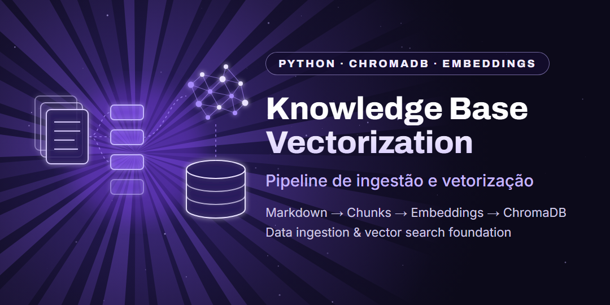

<p align="center">
  
</p>

<p align="center">
  <a href="README.md">🇺🇸 English</a> · <b>🇧🇷 Português</b>
</p>

<p align="center">
  
  
  
  
  <a href="https://github.com/jmarques-data/knowledge-base-vectorization/actions/workflows/testes.yml"></a>
</p>

# Knowledge Base: busca semântica e RAG para suporte de TI

Assistente de suporte técnico em Python: transforma documentação técnica e tickets em embeddings, guarda tudo no ChromaDB e responde perguntas de chamados usando o **Claude** com base nos trechos encontrados, **citando as fontes**.

> **Aviso:** projeto de portfólio. Todos os dados do repositório são sintéticos e fictícios. Nenhum dado real de clientes, tickets ou empresas está incluído.

---

## Arquitetura

```text
INGESTÃO (uma vez)                          PERGUNTA (cada chamado)

Documentos Markdown                         Pergunta do analista
        ↓                                           ↓
Limpeza e sanitização                       Embedding da pergunta
        ↓                                           ↓
Chunking com sobreposição                   Busca semântica no ChromaDB
        ↓                                           ↓
Embeddings (all-MiniLM-L6-v2)               Trechos mais relevantes
        ↓                                           ↓
ChromaDB  ─────────────────────────────→    Prompt com contexto
                                                    ↓
                                            Claude (Anthropic)
                                                    ↓
                                            Resposta com fontes [arquivo#trecho]
```

### O que já funciona

* Ingestão, limpeza e chunking de documentos Markdown
* Geração de embeddings e armazenamento no ChromaDB
* **Busca semântica**: devolve os trechos mais parecidos com a pergunta
* **RAG com o Claude**: responde usando só os trechos encontrados e cita a fonte de cada informação
* **Modo só busca**, que funciona sem chave da API
* **Testes automatizados** (pytest) que rodam no GitHub a cada mudança, sem gastar créditos da API
* Dataset técnico sintético e configuração por `.env`

### Ainda não implementado

* Chunking por seções do Markdown (hoje é por quantidade de caracteres)
* PostgreSQL e busca híbrida
* Interface web ou conversa com memória (hoje cada pergunta é independente)
* Avaliação automática da qualidade das respostas

---

## Tecnologias

* **Python**: linguagem principal
* **ChromaDB**: banco de dados vetorial local
* **all-MiniLM-L6-v2** (via ONNX Runtime): modelo de embeddings, roda no computador
* **Claude** (SDK oficial `anthropic`): geração das respostas
* **pytest** + **GitHub Actions**: testes automatizados
* **python-dotenv**: configuração por variáveis de ambiente

---

## Estrutura do projeto

```text
knowledge-base-vectorization/
│
├── perguntar.py                        # faça perguntas pelo terminal
│
├── src/
│   ├── config.py                       # caminhos, modelo e parâmetros
│   ├── ingestion/
│   │   └── vetorizar_base.py           # chunking + embeddings + ChromaDB
│   ├── retrieval/
│   │   └── busca.py                    # busca semântica
│   └── rag/
│       └── assistente.py               # prompt com contexto + Claude
│
├── knowledge/                          # documentos sintéticos de origem
│   ├── 001_Troubleshooting_SGV_Limpo.md
│   ├── dicionario_bruto.txt
│   ├── 000_Dicionario_Oficial.md       # gerado por estruturar_dicionario.py (não versionado)
│   └── tickets/                        # gerado por sanitizar_tickets.py (não versionado)
│
├── scripts/
│   ├── estruturar_dicionario.py        # dicionário bruto → Markdown estruturado
│   ├── preparar_scripts_sql.py         # cabeçalho + UTF-8 nos scripts SQL
│   ├── sanitizar_tickets.py            # remove campos sensíveis dos tickets
│   └── teste_busca.py                  # teste mínimo da base vetorial
│
├── tests/                              # testes com base e Claude simulados
├── .github/workflows/testes.yml        # roda os testes no GitHub
├── .env.example
├── requirements.txt
└── requirements-dev.txt
```

---

## Instalação

```bash
git clone https://github.com/jmarques-data/knowledge-base-vectorization.git
cd knowledge-base-vectorization
python -m venv venv
```

Ative o ambiente virtual:

```bash
venv\Scripts\activate          # Windows
source venv/bin/activate       # Linux / macOS
```

Instale as dependências e crie o seu `.env`:

```bash
pip install -r requirements.txt
copy .env.example .env         # Windows  (Linux/macOS: cp .env.example .env)
```

### Chave da API do Claude (só para o modo RAG)

1. Crie uma chave em [platform.claude.com](https://platform.claude.com).
2. Cole a chave no seu `.env`, na linha `ANTHROPIC_API_KEY=`.
3. **Nunca** coloque a chave no código, no README ou no GitHub. O `.env` já está no `.gitignore`.

Sem chave, o projeto continua funcionando no **modo só busca**.

> **Windows:** o ONNX Runtime pode precisar do **Microsoft Visual C++ Redistributable 2015–2022** para carregar as DLLs nativas.

---

## Uso

### 1. Prepare os documentos e crie a base vetorial

```bash
python scripts/sanitizar_tickets.py
python scripts/estruturar_dicionario.py
python src/ingestion/vetorizar_base.py
```

Na primeira vez, o modelo de embeddings é baixado (cerca de 80 MB). A pasta `vector_db/` é criada localmente e não vai para o Git.

### 2. Faça perguntas

```bash
python perguntar.py "Sistema não abre: host remoto não encontrado. O que fazer?"
```

A resposta vem em português, com os passos em ordem e a referência de cada informação entre colchetes. No fim aparecem os trechos usados e a distância de cada um (quanto menor, mais parecido com a pergunta).

Exemplo real do modo só busca:

```text
$ python perguntar.py --so-busca "A câmera IP está offline mas o NVR continua pingando"
Base carregada: 7 trechos. Modo: só busca

=== 002_SGV_KnowledgeBase_Consolidada.md#2  (distância 0.775) ===
...
**Solução Prática:** 1. Adicionada exceção no firewall do Windows Defender.
2. Liberada regra no antivírus para a pasta Temp e porta 8080.
...
```

Outras formas de usar:

```bash
python perguntar.py --so-busca "porta 8080 bloqueada"   # só os trechos, sem chamar o Claude
python perguntar.py                                     # modo interativo ("sair" encerra)
```

### 3. Rode os testes

```bash
pip install -r requirements-dev.txt
python -m pytest
```

Os testes usam uma base e um Claude **simulados**: rodam sem internet e sem chave da API.

### Configurações opcionais (`.env`)

| Variável | Padrão | O que faz |
|---|---|---|
| `CLAUDE_MODEL` | `claude-opus-5-5` | Modelo usado nas respostas |
| `CLAUDE_EFFORT` | `medium` | Quanto o modelo pensa: `low`, `medium`, `high`, `xhigh` ou `max` |
| `RAG_TOP_K` | `4` | Quantos trechos a busca envia ao Claude |

---

## Como o RAG evita respostas inventadas

* O Claude recebe **só os trechos encontrados** e é instruído a responder apenas com base neles.
* Cada informação vem com a **referência** do trecho, por exemplo `[001_Troubleshooting_SGV_Limpo.md#1]`, para o analista conferir.
* Se a base não tem a resposta, ele diz que não encontrou e sugere o que investigar.
* O texto dos documentos é tratado como **dado de consulta**: instruções escritas dentro deles são ignoradas.
* Se o modelo principal recusar a pergunta, a API tenta automaticamente um modelo reserva (`fallbacks="default"`).

---

## Dataset e segurança

O projeto usa apenas **dados sintéticos** que simulam cenários como problemas de rede, câmeras indisponíveis, firewall, disco cheio e deadlocks.

O repositório público **não contém** tickets reais, dados de clientes, documentação interna, credenciais, chaves de API, bancos vetoriais de produção nem caminhos pessoais. O `.gitignore` impede o envio de `.env`, ambientes virtuais e `vector_db/`.

---

## Limitações atuais

* **Chunking por caracteres:** pode cortar frases no meio. O próximo passo é dividir por títulos e seções do Markdown.
* **Trechos repetidos:** o arquivo bruto e o consolidado têm o mesmo conteúdo, então a busca pode trazer o mesmo texto duas vezes.
* **Base pequena:** com poucos documentos, a pergunta sempre recebe algum trecho, mesmo que pouco relacionado. O Claude é instruído a dizer quando a base não responde.
* **Sem avaliação automática:** ainda não há um conjunto de perguntas com respostas esperadas para medir a qualidade.

---

## Roadmap

* [x] Ingestão, chunking e embeddings
* [x] Integração com ChromaDB
* [x] Busca semântica
* [x] RAG com Claude e citação das fontes
* [x] Testes automatizados e GitHub Actions
* [ ] Chunking por seções do Markdown e remoção de duplicados
* [ ] Avaliação da qualidade das respostas (conjunto de perguntas de teste)
* [ ] PostgreSQL e busca híbrida
* [ ] Interface conversacional (web ou chat)

---

## Licença

Distribuído sob a [licença MIT](LICENSE).
